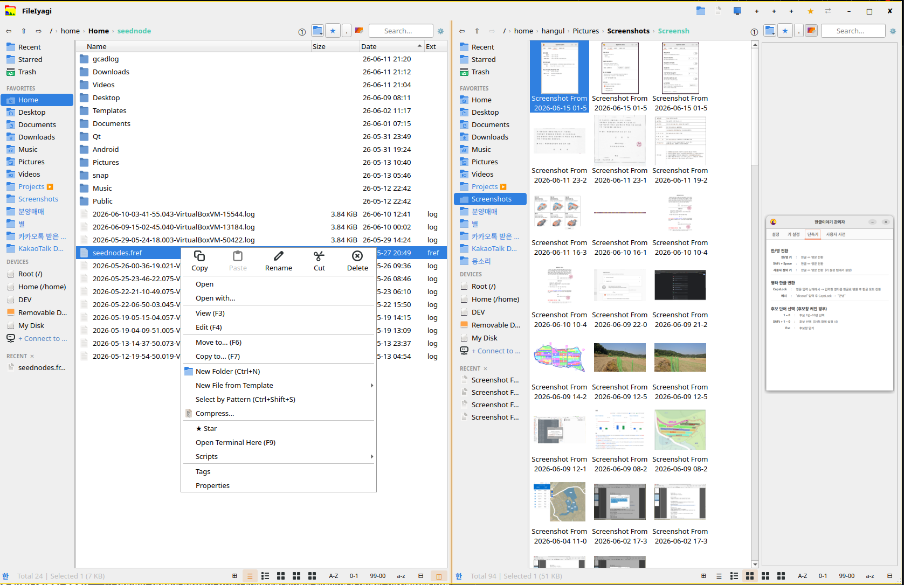
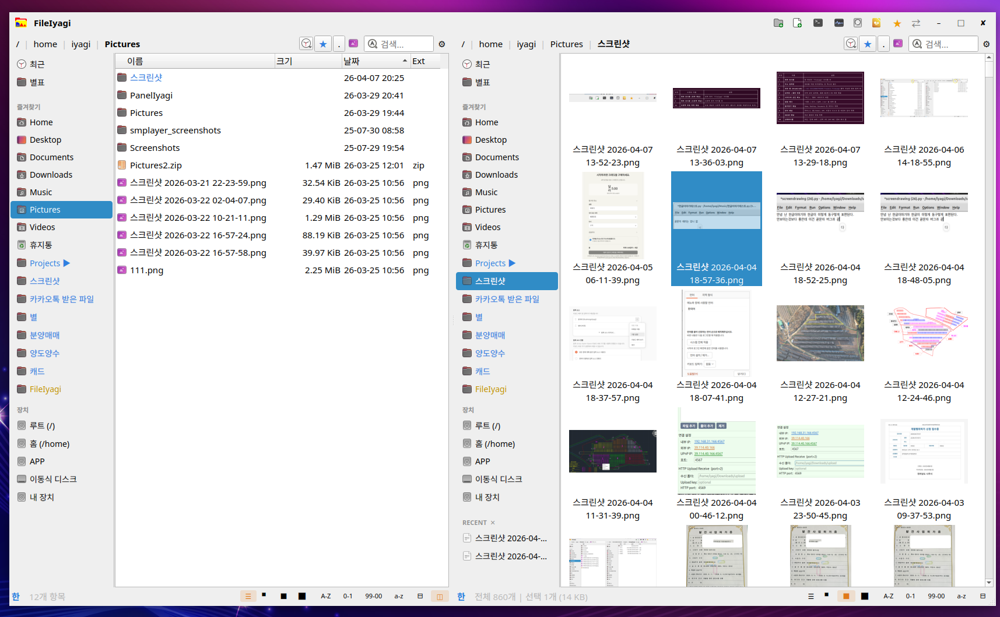

# FileIyagi

**Find, gather, move, open, edit and compare files in one window — a file workbench for Windows and Linux.**
Up to four panes side by side, servers, phones and discs in one sidebar, built-in viewers and editors, and 20-step undo.

[English](README.md) · [한국어](README_ko.md)





## Why FileIyagi

- **Up to four panes.** Copy from one folder to another without juggling windows. Turn on 2, 3 or 4 panes with one button; each pane remembers where it was.
- **Every folder keeps its own look.** Big thumbnails for photos, details for documents — view mode and sort order are remembered per folder and come back next time.
- **Search as you type.** The search box lives in the title bar. Pause typing and it searches every subfolder, results grouped by folder. Korean initials work too (ㄷㅁ → 도면).
- **Servers feel like folders.** SFTP, SMB, FTP and WebDAV behave like a local disk; Android phones and cameras show up when plugged in.
- **Look before you open, fix it on the spot.** Viewer for images, PDF, text, music and Excel; an image editor (crop, obscure, fit to a file size); a text editor with Text Cook; file compare.
- **Mistakes can be undone.** `Ctrl+Z` undoes copy, move, delete and rename, 20 steps deep. Even permanently deleted files (`Shift+Del`) can be brought back for 3 days.
- **Burn CDs, DVDs and Blu-rays without another program.** Data discs, audio CDs and disc images, checked against the originals after burning.
- **The same app on both systems.** Same screens and the same shortcuts on Windows and Linux.

## A tour of the window

| Where | What is there |
|---|---|
| **Title bar** | App icon (About, set as default file manager) · "FileIyagi" title (settings, shortcuts, manual, `Ctrl+F1`) · three custom buttons · yellow ★ (pane-pair bookmark) · ⇄ (Sync + Backup) · **search box** |
| **Toolbar** | Back, forward, up · path bar · blue ★ (bookmark this folder) · recent folders · ① (single-click opens folders) · hidden files · view mode · preview (F11) |
| **Sidebar** | Bookmarks · devices (drives, USB, phones, CD/DVD drives) · servers · recent files · starred files · tags |
| **Status bar** | Selection count and size · sort buttons · subfolder grid · 🧺 basket · ◫ split |

### Two panes, and fixing files in place

Each folder remembers its own view: thumbnails on the left, details on the right.


Open an image with `F4` and crop, adjust or mark it up without leaving the window. The original stays untouched until you press save.


## Features

### Getting around
- **Path bar** — click a block to go there. Clicking the current folder copies its path; select a file and a file-name block appears at the end that copies the file's full path. Click empty space or press `F12` to type a path (`~` works)
- **Back, forward, up** — `Alt+←/→`, `Backspace` or `Alt+↑`, mouse buttons 4 and 5
- **Bookmarks** — standard folders plus your own. Hold `Alt` to see their numbers and jump with `Alt+1–9`
- **Recent folders** (the last 10, kept across restarts) and **recent files** — files your browser downloads are added automatically
- **Type to jump** — type in the list to jump to the first matching name. Korean initials work (ㅌㅇ → 태양, 토양); `Space` goes to the next match; `Shift+Space` or the Han/Eng key switches between Korean and English
- **Single-click** — turn on ① to open folders with one click

### Views — remembered per folder
- **Details** (`Ctrl+1`) · **list** (`Ctrl+2`) · **small/medium/large icons** (`Ctrl+3–5`), `Ctrl+wheel` cycles them
- **Sort** — name, size, date, extension (`Ctrl+6–9`, status-bar buttons, column headers); `Ctrl+0` fits column widths
- **Quick filter** — in details view, click an extension or date cell to show only that extension or that day; click again or press `Esc` to clear
- **Thumbnails** — images (HEIC included), videos and PDF first pages, visible items first, cached for next time
- **Subfolder grid** (`Ctrl+Tab`) — folders as a grid on top, files below; only in folders where you turned it on
- **Hidden files** (`Ctrl+H`), **font size** (`Ctrl+↑/↓`, `Alt+wheel`), columns that widen with the font
- **Themes** — icon theme, folder color, sidebar and list row height, 12 interface languages

### Search
- **Title-bar search box** — always there (`Ctrl+F`); searches the folder of the pane you used last, including all subfolders
- **Results grouped by folder** — click a folder row to go there; icon and thumbnail views work on results
- **How to search** — Korean initials (`ㄷㅁ`), several words (`plan+.pdf`), patterns (`*plan*.pdf`, `?` = one character)
- **Search options** — inside text files (up to 5 MB), date (today, this week/month/year), size, files or folders only
- **Work right in the results** — open, copy, move, delete, preview, drag into other apps, compress, extract. Results stay after opening a file; Back closes the search
- **Select by pattern** (`Ctrl+Shift+S`) — e.g. every `*.jpg` in the current folder

### Working with files
- **Copy** (`F7`) · **Move** (`F6`) — a folder chooser with bookmarks and devices; the progress window shows remaining size and speed, and queued items can be removed. On USB and other removable media the copy finishes only once the data is really written
- **Clipboard** — `Ctrl+C` · `Ctrl+X` · `Ctrl+V`, also with other file managers
- **Rename** (`F2`) — starts with the name selected, extension excluded
- **Batch rename** (`F8`) — prefix, suffix, find and replace, numbering, new name, with a preview
- **New folder** (`Ctrl+N`), **new folder with selection**, **new file from template**, `F4` with nothing selected for a new text file
- **Delete** — `Del` moves to the trash, `Shift+Del` deletes permanently, yet the last 50 are kept for 3 days so `Ctrl+Z` can restore them; review or empty them in Settings → Deleted Files
- **Trash** (`Ctrl+Shift+T`) — select and press `R` to restore
- **Undo** (`Ctrl+Z`) — create, delete, copy, move and batch rename, 20 steps
- **Stars and tags** — starred files gather in the sidebar; tags are written into the file itself (Linux extended attributes / Windows NTFS streams) and follow it when moved
- **Open with** — remembers the last app chosen for each file type
- **Properties** — size, path, dates, folder file count and size, permissions, image/music/video details, combined size of several items, and **the prompt, model and settings of AI-generated images**
- **More on right-click** — open in new window, open file location, open or run as administrator, install a .deb package (with a [Run] button afterwards), Nautilus scripts (Linux)

### Drag and drop
- Dropping files opens a menu: **copy, move or shortcut** — no guessing what happened
- Hold `Shift` while dropping for a **copy with a new name**, no menu
- Swipe across files to **select them**, like on Android — nothing moves by accident
- Path-bar blocks, the sidebar, other panes and other apps (browsers) accept drops too

### Basket and archives
- **Basket** (`Alt+B`) — collect files from many folders, then compress, copy, move or delete them at once from 🧺 in the status bar
- **Compress** — zip · tar.gz · tar.bz2 · tar.xz · 7z
- **One archive from several folders** — keep the Compress window open, select files in another folder or pane and press "Add Selection" or drag them in; search results work too
- **Extract** — double-click an archive to extract it into a folder of the same name, or right-click → Extract Here

### Split panes (2, 3, 4)
- `F1` or ◫ in the status bar for two panes; the right pane's ◫ adds a third, the third pane's ◫ a fourth
- Each layout remembers its pane ratio and every pane's folder
- **Yellow ★** — while split it saves the pair of folders; in single mode (or from the yellow ★ in the sidebar) it restores them
- In 3–4 pane mode, **enlarge the active pane** and **dim inactive panes** (color selectable)
- **Three window sizes** (`Ctrl+S`); size and position are remembered

### Sync + Backup (`F10`)
- With two panes open, left is the source and right the target
- **One-way backup** (new and changed files only) or **two-way sync** (newer files both ways). Files on only one side can be copied over or deleted
- Match by name regardless of folders; treat files of the same size as identical
- **Text and source files only** (decided by content, not extension), plus extensions to always include or exclude
- Preview every change in a table, then run

### Viewing
- **Viewer** (`F3`) — images, PDF, text, music and Excel (.xlsx) in one window
  - `←/→` previous/next file of the same kind, `Home/End` first/last
  - Images: slideshow (`Space` pauses), full screen (`F`), rotate (`R`/`Shift+R`), "Apply to all photos" keeps the angle for the next ones
  - PDF: pages (`PgUp/PgDn`), zoom (`+/-`) · text: find (`Ctrl+F`) · print (`Ctrl+P`)
- **Quick preview** (`F11`) — images, text, music and video beside the list as you select. Music turns the folder into a playlist and skips unchecked songs. With "keep playing after closing", music continues after F11 closes and a small player bar remains. Choose the audio output device
- **Compare** (`Ctrl+D`) — two files side by side, differences marked
- **Terminal** (`F9`) — in the current folder

### Editing (`F4`)
- **Text editor** — save (`Ctrl+S`), find (`Ctrl+F`), line numbers, font, print (`Ctrl+P`)
- **Text Cook** (`Ctrl+Shift+K`) — cleans up pasted, OCR and subtitle text in one go: tidy OCR text, one sentence per line, join lines within paragraphs, all on one line, tidy spaces, single or no blank lines, subtitle (SRT) dialogue only
- **Image editor** (`F4` on an image)
  - **Crop** (fixed ratios 1:1, 4:3, 3:2, 16:9 and more), **rotate, flip, straighten**, **resize** (25/50/75%, long edge 800–3840 px)
  - **Color** (brightness, contrast, saturation, hue, gamma, auto), **effects** (grayscale, sepia, invert, sharpen, blur, border)
  - **Drawing** — pen, marker, line, arrow, rectangle, ellipse, text and watermark, plus **obscure**: a mosaic over faces or account numbers that really discards the pixels
  - **Fit to a file size** — type "250 KB" and it adjusts quality (color levels for PNG) while keeping the resolution; shrinking the image happens only if you allow it
  - Undo (`Ctrl+Z`), save (`Ctrl+S`) and Save As — **the original changes only when you save**
- **Excel** — open, edit and save .xlsx without Excel

### Disc burning — CD, DVD, Blu-ray (`Ctrl+B`)
- Select files and press `Ctrl+B` or right-click → Burn to Disc. The burning engine is built in
- **Data disc** — leave it open to add more later, or close it. The burned files are checked against the originals
- **Audio CD** — MP3, FLAC, OGG, M4A, WAV and more converted to CD quality; reorder the tracks
- **Disc image** — burn an ISO, or save a disc as an ISO (all sessions of a multi-session disc)
- **Erase** — CD-RW, DVD±RW, DVD-RAM, BD-RE
- **Burn speed** — choose from the speeds the drive reports for that disc, or let the drive decide
- **Videos that play straight from the disc** — phone videos (MP4, MOV) get their index moved to the front in the burned copy only; the originals stay untouched
- **Long names stay readable on Windows** (up to 103 characters)
- Drives stay in the sidebar even when empty and follow disc changes at once. Disc thumbnails can stay in memory or be saved per disc

### Servers, devices and network
- **Connect to a server** — SFTP · SMB · FTP · WebDAV, like a local disk
- **Remote terminal** (`Ctrl+Shift+C`) — in an SFTP/SSH folder, a terminal for that server docks under the file list; run selected files from the right-click menu
- **Android (MTP), cameras and network drives** appear automatically. "My Devices" lists unmounted disks too; click to mount
- **Send and receive files over the network** between PCs on the same network
- **Windows: read Linux EXT4 partitions** — with views, sorting, copying and drag and drop
- **Windows: recover permanently deleted files**

### System integration
- **Default file manager** — one button from the title-bar icon
- **Replaces other apps' open and save dialogs** — FileIyagi appears when a browser attaches or saves a file. Gather files from several folders to attach at once, paste a clipboard image directly, and get the next numbered name when saving
- **Windows: `Win+E` opens FileIyagi instead of Explorer**
- **Three custom buttons** — any app or command, with `%f` for the selected file
- Uses the input method you chose (Korean included)

### Linux convenience tools (Settings → Convenience)
- **Hibernate and screen lock** — find out why suspend, hibernate or locking fails and fix it in one step, including programs that block sleep
- **Log analysis** — why the PC went down and why apps crashed, as causes and fixes instead of raw logs
- **Journal flood guard** — stops one program from filling the disk with logs
- **Extract audio from video** — without re-encoding, and merge it back; reads damaged AVI files
- **System information** — hardware specs, driver and PCI ID per device, firmware errors, USB, temperatures; everything can be copied

## Keyboard shortcuts

Full list in the app: Settings (`Ctrl+F1`) → **Key Shortcuts**

**Function keys**

| Key | Action | Key | Action |
|---|---|---|---|
| `F1` | Toggle two panes | `F7` | Copy |
| `F2` | Rename | `F8` | Batch rename |
| `F3` | Viewer | `F9` | Terminal |
| `F4` | Editor (image editor for images, new file if nothing selected) | `F10` | Sync + Backup |
| `F5` | Refresh + fit columns | `F11` | Quick preview |
| `F6` | Move | `F12` | Type a path |
| `Del` | Move to trash | `Shift+Del` | Delete permanently (restorable for 3 days) |
| `Alt+B` | Add to basket | `R` | Restore from trash |

**Ctrl keys**

| Key | Action | Key | Action |
|---|---|---|---|
| `Ctrl+C` `X` `V` | Copy, cut, paste | `Ctrl+B` | Burn to disc |
| `Ctrl+Z` | Undo | `Ctrl+S` | Cycle window size |
| `Ctrl+N` | New folder | `Ctrl+Tab` | Subfolder grid |
| `Ctrl+F` | Go to search box | `Ctrl+Shift+S` | Select by pattern |
| `Ctrl+H` | Hidden files | `Ctrl+Shift+T` | Trash |
| `Ctrl+R` | Refresh | `Ctrl+Shift+C` | Remote terminal (SFTP/SSH) |
| `Ctrl+D` | Compare files | `Ctrl+F1` | Settings, shortcuts, manual |

**Views and navigation**

| Key | Action | Key | Action |
|---|---|---|---|
| `Ctrl+1–5` | Details, list, small/medium/large icons | `Alt+←/→` | Back, forward |
| `Ctrl+6–9` | Sort by name, size, date, extension | `Backspace` `Alt+↑` | Parent folder |
| `Ctrl+0` | Fit column widths | `Alt+1–9` | Go to bookmark |
| `Ctrl+↑/↓` `Alt+wheel` | Font size | Type letters | Jump to matching file (Korean initials work) |
| `Ctrl+wheel` | Cycle view modes | `Space` | Next match of the typed letters |
| `Esc` | Cancel search or filter | `Shift+drop` | Copy with a new name |

**Viewer (F3) and editor (F4)**

| Key | Action | Key | Action |
|---|---|---|---|
| `←/→` | Previous/next file (`Alt+←/→` in text) | `Ctrl+S` | Save |
| `Home/End` | First/last file | `Ctrl+Z` | Undo |
| `Space` | Pause slideshow / play or pause music | `Ctrl+F` | Find |
| `F` · `Esc` | Full screen · leave or close | `Ctrl+Shift+K` | Text Cook |
| `PgUp/PgDn` `+/-` | PDF pages, zoom | `Ctrl+P` | Print |
| `R` `Shift+R` | Rotate | | |

## Download

**[⬇ Get the latest version](https://github.com/iyagicom/FileIyagi/releases/latest)**

| Your system | File to download |
|---|---|
| Windows 10 / 11 | [Microsoft Store](https://apps.microsoft.com/search?query=FileIyagi) |
| Ubuntu 24.04 · Debian | `.deb` tagged **ubuntu24.04** |
| Ubuntu 26.04 | `.deb` tagged **ubuntu26.04** |
| Fedora · openSUSE | `.rpm` |
| Arch · Manjaro | `.pkg.tar.zst` |
| Any other Linux | `.AppImage` (runs without installing) or `.zip` |

```bash
sudo apt install ./fileiyagi_*_amd64.deb     # Ubuntu / Debian
sudo dnf install ./fileiyagi-*.rpm           # Fedora
sudo pacman -U fileiyagi-*.pkg.tar.zst       # Arch
```

Everything it needs is included — nothing else to install.

## License

[License](LICENSE) · [Privacy policy](privacy-policy.md)
