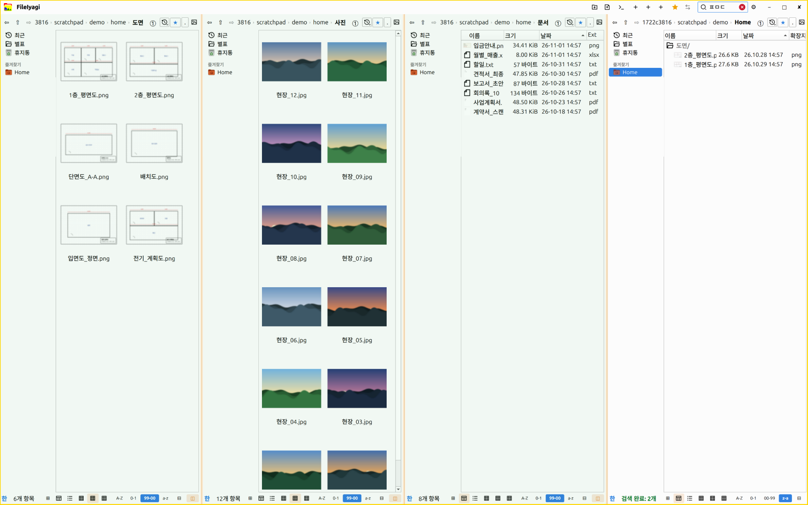
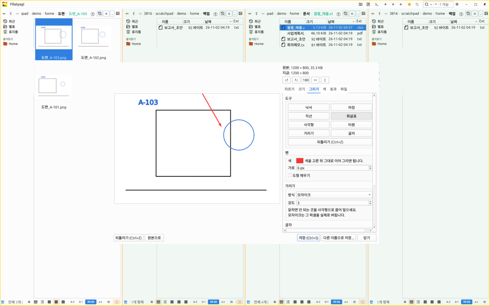
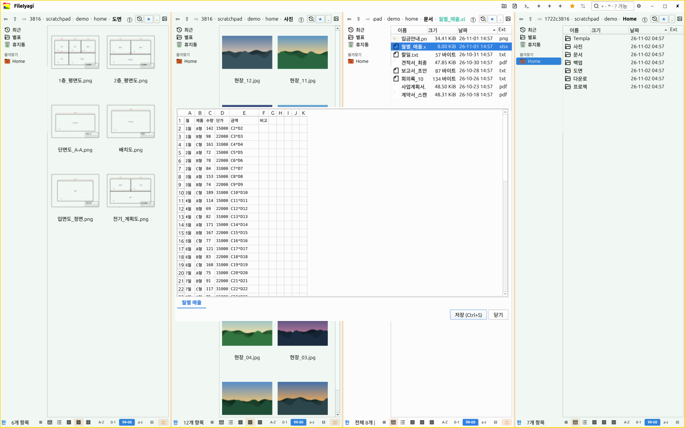
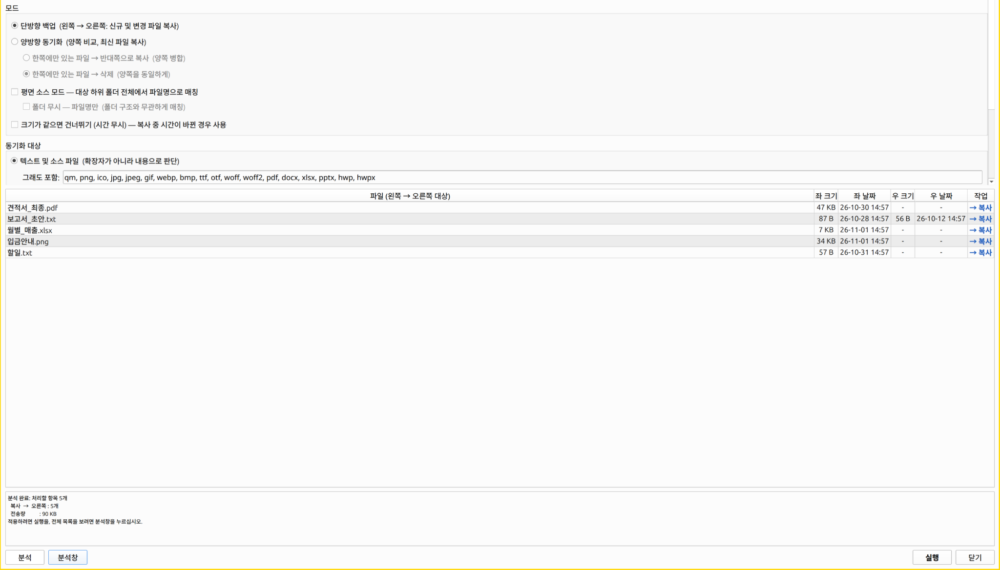
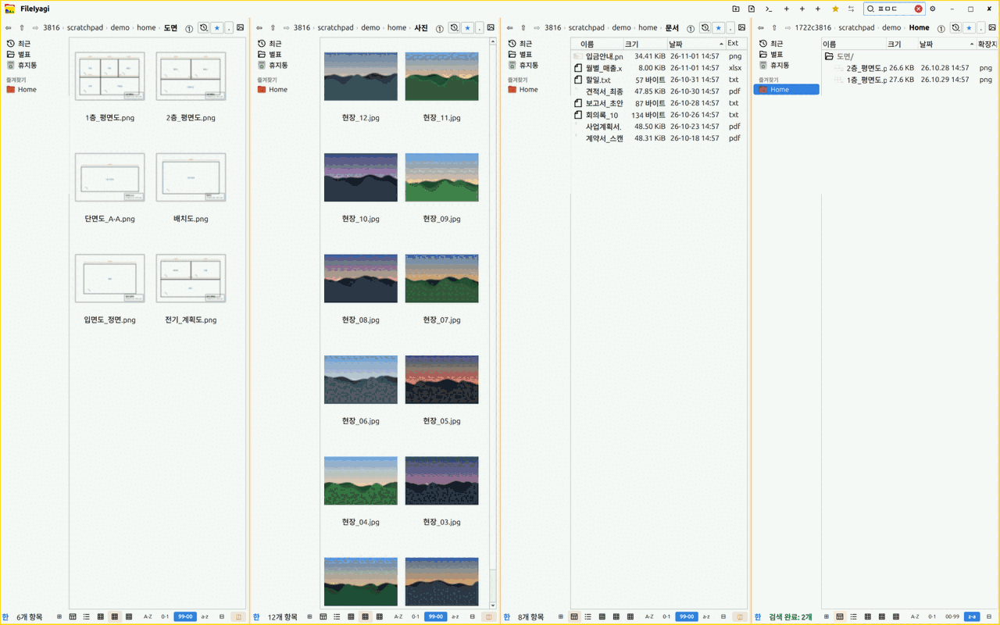

# 파일이야기 (FileIyagi)

**파일 찾기부터 옮기기·열기·고치기까지 한 창에서 — Windows·Linux 파일 작업대.**
창을 최대 4칸으로 나누고, 서버·휴대폰·디스크를 사이드바 하나에 모으고, 그림·PDF·글·엑셀을 다른 앱 없이 열어 고치고, 실수는 20단계까지 되돌립니다.

**[⬇ 최신판 받기](https://github.com/iyagicom/FileIyagi/releases/latest)** · Windows: [Microsoft Store](https://apps.microsoft.com/search?query=FileIyagi) · Linux: deb · rpm · zst · AppImage · zip ([내려받기 안내](#다운로드))

[English](README.md) · [한국어](README_ko.md)



## 핵심 기능

### 1. 한 창에 최대 4칸
도면은 썸네일로, 문서는 목록으로 — 칸마다 폴더와 보기 방식을 따로 기억합니다. 창을 여러 개 띄워 오갈 필요 없이 이 칸에서 저 칸으로 바로 복사·옮기기를 합니다. 한글은 초성만 쳐도 찾아 줍니다 — 위 그림 오른쪽 끝 칸이 `ㅍㅁㄷ` 으로 찾은 결과(평면도)입니다.

### 2. 다른 앱을 열지 않고 그 자리에서 고치기 (`F4`)

| 이미지 편집기 | 엑셀(.xlsx) 편집 |
|---|---|
|  |  |

그림은 자르기·돌리기·크기·빛깔·효과·그리기(화살표·글자·모자이크 가리기)까지, 글은 글 편집기와 글자 요리로 고칩니다. 모자이크로 가린 부분은 그 픽셀을 실제로 버려 되살릴 수 없습니다. **저장을 누르기 전까지 원본은 그대로입니다.**

### 3. 실행 전에 미리 보는 동기화·백업 (`F10`)
무엇이 복사될지 표로 먼저 보고, 확인한 뒤에 실행합니다. 한쪽 백업(새 것·바뀐 것만)과 양쪽 맞추기를 고를 수 있습니다.



### 4. 서버·휴대폰·디스크를 내 폴더처럼
SFTP·SMB·FTP·WebDAV 와 안드로이드 휴대폰(MTP)을 사이드바에서 바로 열고, SFTP/SSH 폴더에는 원격 터미널이 붙습니다. Windows 에서는 리눅스 EXT4 파티션도 읽습니다.

### 5. 실수해도 되돌립니다
`Ctrl+Z` 로 복사·옮기기·지우기·이름 바꾸기를 20단계까지, 영구 삭제(`Shift+Del`)한 파일도 3일 동안은 되살립니다. USB 로 복사할 때는 실제로 다 써졌는지 확인한 뒤에야 끝냅니다.



## v2.46.1 새 기능
- **무엇이든 찾기** (`Ctrl+F` 두 번) — 명령·폴더·파일을 찾고, 한글 초성 찾기와 지금 폴더만 빠르게 걸러 보기를 함께 씁니다.
- **칸마다 탭** — 각 칸에 여러 폴더를 열어 두고 오갑니다.
- **압축 속 들여다보기** — 압축을 풀기 전에 폴더처럼 살펴보고 필요한 것만 풉니다.
- **파일 작업판** (`Ctrl+J`) — 복사·옮기기·지우기·압축 풀기 진행을 한곳에서 보고, 멈춤·이음·취소와 이름 충돌 처리를 합니다.
- **Git·트리 보기·사용자 작업** — 파일 목록에 Git 상태를 표시하고, 폴더를 트리로 보며, 셸을 거치지 않는 JSON 작업을 실행합니다.
- **파일·폴더 고정** — 자주 쓰는 항목을 폴더 위쪽에 둡니다.
- **터미널에서 파일 실행** — 우클릭 메뉴나 `Shift+F9`를 씁니다.
- **좁은 목록과 원격 폴더 개선** — 긴 이름 옆에도 크기·날짜·확장자가 보이고, Linux SFTP 목록은 뒤에서 불러옵니다.
- **사진 번호를 엑셀에 맞추기** — 사진에서 모듈 번호를 읽어 알맞은 엑셀 파일에 넣습니다. Linux에서 쓸 수 있고 Windows 꾸러미에는 OCR 엔진을 더해야 합니다.
- **뒤로 가기와 브라우저 첨부 개선.**

## 그 밖의 장점

핵심 기능 5가지 말고도 이런 점이 있습니다.

- **폴더마다 제 모습으로.** 사진 폴더는 큰 썸네일, 문서 폴더는 자세히 — 보기 방식과 정렬을 폴더마다 따로 기억해 다음에도 그대로 열립니다.
- **치는 대로 찾습니다.** 찾기 칸이 제목 표시줄에 늘 있습니다. 치다 멈추면 하위 폴더까지 찾아 폴더별로 묶어 보여 주고, 파일 안 글·날짜·크기로도 거릅니다.
- **CD·DVD·블루레이를 따로 프로그램 없이 굽습니다.** 데이터·오디오 CD·디스크 이미지, 구운 뒤 원본과 같은지까지 살핍니다.
- **두 OS 에서 같은 앱.** Windows 와 Linux 를 오가도 화면도 단축키도 같습니다.

## 화면 둘러보기

| 자리 | 무엇이 있나 |
|---|---|
| **제목 표시줄** | 앱 아이콘(정보·기본 파일 관리자로 정하기) · 「FileIyagi」 글자(설정·단축키·도움말, `Ctrl+F1`) · 내가 거는 단추 3개 · 노란 ★(칸 짝 북마크) · ⇄(동기화+백업) · **찾기 칸** |
| **도구 모음** | 뒤로·앞으로·위로 · 경로 막대 · 파란 ★(이 폴더를 즐겨찾기에) · 최근 폴더 · ①(한 번 눌러 폴더 열기) · 숨김 파일 · 보기 방식 · 미리보기(F11) |
| **사이드바** | 즐겨찾기 · 장치(드라이브·USB·휴대폰·CD/DVD 드라이브) · 서버 · 최근 파일 · 별표 파일 · 태그 |
| **아래 줄** | 고른 파일 수·크기 · 정렬 단추 · 하위 폴더 격자 · 🧺 바구니 · ◫ 칸 나누기 |

## 기능

### 돌아다니기
- **경로 막대** — 칸을 누르면 그 폴더로. 지금 폴더 칸을 누르면 경로가 복사되고, 파일을 하나 고르면 끝에 파일 이름 칸이 생겨 누르면 그 파일의 전체 경로가 복사됩니다. 빈 곳을 누르거나 `F12` 로 경로를 직접 칩니다(`~` 됨)
- **뒤로·앞으로·위로** — `Alt+←/→`, `Backspace`·`Alt+↑`, 마우스 옆 단추(4·5번)
- **즐겨찾기** — 홈·바탕화면·문서 같은 기본 폴더와 내가 건 북마크. `Alt` 를 누르고 있으면 번호가 떠 `Alt+1~9` 로 바로 갑니다
- **최근 폴더**(마지막 10곳, 껐다 켜도 남음)와 **최근 파일** — 브라우저로 내려받은 파일도 저절로 들어옵니다
- **치면 그 파일로** — 목록에서 글자를 치면 그 글자로 시작하는 파일로 갑니다. 한글은 초성만(ㅌㅇ → 태양·토양), `Space` 로 다음 파일, `Shift+Space`·한/영 키로 한글·영문 바꾸기
- **한 번 눌러 열기** — 도구 모음 ① 을 켜면 폴더가 한 번에 열립니다

### 보기 — 전부 폴더마다 기억합니다
- **자세히**(`Ctrl+1`) · **목록**(`Ctrl+2`) · **아이콘 소·중·대**(`Ctrl+3~5`), `Ctrl+휠` 로 차례로
- **정렬** — 이름·크기·날짜·확장자(`Ctrl+6~9`, 아래 줄 단추, 열 머리), `Ctrl+0` 열 폭 맞추기
- **한 가지만 보기** — 자세히 보기에서 확장자 칸이나 날짜 칸을 누르면 그 확장자·그날 파일만 남습니다. 다시 누르거나 `Esc` 로 풀립니다
- **썸네일** — 그림(HEIC 포함)·동영상·PDF 첫 쪽. 화면에 보이는 것부터 만들고, 한 번 만든 것은 바로 뜹니다
- **하위 폴더 격자**(`Ctrl+Tab`) — 폴더는 위에 격자로, 아래 목록에는 파일만. 켠 폴더에서만 켜집니다
- **숨김 파일**(`Ctrl+H`), **글자 크기**(`Ctrl+↑/↓`, `Alt+휠`), 글자 크기에 맞춰 넓어지는 열
- **테마** — 아이콘 테마, 폴더 빛깔, 사이드바·목록 줄 높이, 12개 화면 언어

### 찾기
- **제목 표시줄 찾기 칸** — 늘 떠 있고(`Ctrl+F`), 마지막으로 쓴 칸의 폴더에서 하위 폴더까지 다 찾습니다
- **폴더별로 묶인 결과** — 폴더 줄을 누르면 그 폴더로. 아이콘·썸네일 보기도 그대로
- **찾는 법** — 초성(`ㄷㅁ`), 여러 낱말(`도면+.pdf`), 패턴(`*도면*.pdf`, `?` 는 한 글자)
- **찾기 옵션** — 파일 안 글 찾기(5MB 까지의 글 파일), 날짜(오늘·이번 주·이번 달·올해), 크기, 파일만·폴더만
- **결과에서 바로 작업** — 열기·복사·옮기기·지우기·미리보기·다른 앱으로 끌어다 놓기·압축·압축 풀기. 파일을 열어도 결과는 남고, 뒤로 가기는 찾기를 닫습니다
- **패턴으로 고르기**(`Ctrl+Shift+S`) — 지금 폴더에서 `*.jpg` 처럼 한꺼번에

### 파일 다루기
- **복사**(`F7`) · **옮기기**(`F6`) — 즐겨찾기·장치가 보이는 폴더 고르기 창. 진행 창에 남은 양과 속도, 기다리는 항목은 목록에서 뺄 수 있습니다. USB 같은 바깥 장치는 실제로 다 써졌는지 살핀 뒤에야 끝냅니다
- **클립보드** — `Ctrl+C` · `Ctrl+X` · `Ctrl+V`, 다른 파일 관리자와도 주고받습니다
- **이름 바꾸기**(`F2`) — 확장자를 뺀 이름만 골라진 채로 시작
- **일괄 이름 바꾸기**(`F8`) — 앞·뒤에 붙이기, 찾아 바꾸기, 번호 매기기, 새 이름, 미리 보고 실행
- **새 폴더**(`Ctrl+N`), **고른 것으로 새 폴더**, **템플릿으로 새 파일**, 아무것도 안 고르고 `F4` 는 새 글 파일
- **지우기** — `Del` 은 휴지통으로, `Shift+Del` 은 영구 삭제. 영구 삭제한 것도 최근 50개를 3일 동안 넣어 두어 `Ctrl+Z` 로 되살리고, 설정 → 「지운 파일」에서 보고 골라 비웁니다
- **휴지통**(`Ctrl+Shift+T`) — 고르고 `R` 로 되살리기
- **되돌리기**(`Ctrl+Z`) — 만들기·지우기·복사·옮기기·일괄 이름 바꾸기를 20단계까지
- **별표·태그** — 별표 파일은 사이드바에 모이고, 태그는 파일 자체에 적혀(리눅스 확장 속성 / Windows NTFS 스트림) 옮겨도 따라갑니다
- **연결 프로그램** — 파일 종류마다 마지막에 고른 앱을 기억
- **속성** — 크기·경로·날짜, 폴더 안 파일 수와 용량, 권한 바꾸기, 그림·노래·동영상 정보, 여러 개 합친 용량. **AI 로 만든 그림은 프롬프트·모델·설정까지** 보여 줍니다
- **그 밖의 우클릭** — 새 창에서 열기, 파일 위치 열기, 관리자 권한으로 열기·실행, deb 꾸러미 바로 설치(끝나면 [실행]), 노틸러스 스크립트(리눅스)

### 끌어 놓기
- 놓으면 **복사·옮기기·바로가기** 중 고르는 메뉴가 뜹니다 — 어디로 갔는지 몰라 헤매는 일이 없습니다
- `Shift` 를 누른 채 놓으면 메뉴 없이 **새 이름으로 사본**
- 파일 위를 그어 지나가면 안드로이드처럼 **여러 개가 골라집니다** — 실수로 옮겨지지 않습니다
- 경로 막대의 폴더 칸·사이드바·다른 칸·다른 앱(브라우저 등)과도 주고받습니다

### 바구니 · 압축
- **바구니**(`Alt+B`) — 여러 폴더를 돌며 파일을 담아 두었다가 아래 줄 🧺 에서 압축·복사·옮기기·지우기를 한 번에
- **압축** — zip · tar.gz · tar.bz2 · tar.xz · 7z
- **여러 폴더의 파일을 한 압축 파일로** — 압축 창을 띄워 둔 채 다른 폴더(다른 칸)로 가서 고르고 「고른것 담기」를 누르거나 창으로 끌어다 놓으면 목록에 모입니다. 찾기 결과에서 고른 파일도 됩니다
- **압축 풀기** — 두 번 누르면 이름대로 폴더를 만들어 풉니다. 우클릭 「여기에 압축 풀기」

### 여러 칸 (2·3·4칸)
- `F1` 또는 아래 줄 ◫ 로 2칸. 오른쪽 칸의 ◫ 은 3칸, 셋째 칸의 ◫ 은 4칸
- 칸 수마다 칸 비율과 각 칸의 폴더를 따로 기억
- **노란 ★** — 나뉜 상태에서 누르면 두 칸의 폴더 짝을 담고, 한 칸일 때 누르면(또는 사이드바 노란 ★) 그 짝으로 되돌립니다
- 3·4칸에서 **지금 쓰는 칸 넓히기**, 쓰지 않는 칸에 **흐린 막**(빛깔 고르기)
- **창 크기 3단계**(`Ctrl+S`), 창 크기·자리 기억

### 동기화 + 백업 (`F10`)
- 두 칸을 열고 누르면 왼쪽이 원본, 오른쪽이 대상
- **한쪽 백업**(새 것·바뀐 것만) 또는 **양쪽 맞추기**(더 새것을 서로). 한쪽에만 있는 파일은 「반대쪽으로 복사」 또는 「지우기」
- 폴더 구조 무시하고 이름으로 맞추기, 크기만 같으면 같은 파일로 보기
- **글·소스 파일만** 맞추기(확장자가 아니라 알맹이를 읽어 가림), 꼭 넣을·뺄 확장자
- 무엇이 바뀔지 표로 먼저 보고 실행

### 열어 보기
- **뷰어**(`F3`) — 그림·PDF·글·노래·엑셀(.xlsx)을 한 창에서
  - `←/→` 같은 종류의 앞뒤 파일, `Home/End` 처음·끝
  - 그림: 자동 넘김(`Space` 로 멈춤), 전체 화면(`F`), 돌리기(`R`/`Shift+R`), 「모든 사진 적용」 으로 다음 사진도 같은 각도로
  - PDF: 쪽 넘기기(`PgUp/PgDn`), 확대·축소(`+/-`) · 글: 찾기(`Ctrl+F`) · 인쇄(`Ctrl+P`)
- **빠른 미리보기**(`F11`) — 고르는 대로 옆에 그림·글·노래·동영상. 노래는 폴더가 재생 목록이 되고 체크를 뺀 곡은 건너뜁니다. 「닫아도 계속 재생」을 켜면 F11 을 닫아도 노래가 이어지고 작은 재생 막대가 남습니다. 소리 낼 장치도 고릅니다
- **파일 비교**(`Ctrl+D`) — 두 파일을 나란히, 다른 줄 표시
- **터미널**(`F9`) — 지금 폴더에서

### 고치기 (`F4`)
- **글 편집기** — 저장(`Ctrl+S`)·찾기(`Ctrl+F`)·줄 번호·글꼴·인쇄(`Ctrl+P`)
- **글자 요리**(`Ctrl+Shift+K`) — 복사해 온 글·OCR 글·자막을 한 번에 다듬습니다: OCR 글 다듬기, 한 문장에 한 줄, 문단 안 줄바꿈 잇기, 한 줄로, 띄어쓰기 다듬기, 빈 줄 하나로·모두 없애기, 자막(SRT) 대사만 뽑기
- **이미지 편집기**(그림에서 `F4`)
  - **자르기**(비율 고정 1:1·4:3·3:2·16:9 등), **돌리기·뒤집기·기울기 바로잡기**, **크기 줄이기**(25/50/75%, 긴 변 800~3840px)
  - **빛깔 손보기**(밝기·대비·채도·색조·감마·자동), **효과**(흑백·세피아·반전·선명하게·흐리게·테두리)
  - **그리기** — 펜·형광펜·직선·화살표·사각형·타원·글쓰기·워터마크, 그리고 **가리기**: 얼굴·계좌번호를 모자이크로 덮고 그 픽셀은 실제로 버려 되살릴 수 없습니다
  - **목표 용량 맞추기** — 「250KB」처럼 적으면 해상도는 그대로 두고 품질(PNG 는 색 단계)로 맞춥니다. 해상도까지 줄이는 것은 직접 켰을 때만
  - 되돌리기(`Ctrl+Z`), 저장(`Ctrl+S`)·다른 이름으로 저장 — **원본은 저장을 눌러야 바뀝니다**
- **엑셀** — 엑셀 없이 .xlsx 를 열어 고치고 저장

### 디스크 굽기 — CD·DVD·블루레이 (`Ctrl+B`)
- 파일을 고르고 `Ctrl+B` 나 우클릭 「디스크에 굽기」. 굽기 엔진이 들어 있어 더 깔 것이 없습니다
- **데이터 디스크** — 닫지 않은 디스크에는 나중에 더 담고, 「디스크 닫기」로 마무리. 다 구운 뒤 원본과 같은지 살핍니다
- **오디오 CD** — MP3·FLAC·OGG·M4A·WAV 등을 CD 음질로 저절로 바꿔 굽고, 곡 차례는 위·아래로
- **디스크 이미지** — ISO 굽기, 디스크를 ISO 로 저장(이어 구운 디스크도 모든 세션을 담습니다)
- **지우기** — CD-RW·DVD±RW·DVD-RAM·BD-RE
- **굽는 속도** — 드라이브가 그 디스크에 알려 주는 배속에서 고르거나 드라이브에 맡깁니다
- **디스크에서 바로 틀리는 동영상** — 휴대폰 동영상(MP4·MOV)의 재생 목차를 굽는 사본에서만 앞으로 옮깁니다. 원본은 그대로
- **Windows 에서도 긴 한글 이름 그대로**(103자까지)
- 드라이브는 빈 채로도 사이드바에 있고 디스크를 바꿔 넣으면 바로 따라갑니다. 디스크 썸네일은 메모리에만 두거나 디스크마다 따로 저장

### 서버 · 장치 · 네트워크
- **서버에 연결** — SFTP · SMB/삼바 · FTP · WebDAV 를 내 디스크처럼
- **원격 터미널**(`Ctrl+Shift+C`) — SFTP/SSH 폴더를 보고 있으면 파일 목록 아래에 그 서버의 터미널이 붙습니다. 고른 파일은 우클릭으로 바로 실행
- **안드로이드(MTP)·카메라·네트워크 드라이브** 자동 표시. 「내 장치」에서는 마운트 안 된 디스크까지 보이고 눌러서 연결
- **네트워크로 파일 보내고 받기** — 같은 망의 PC 끼리
- **Windows: 리눅스 EXT4 파티션 읽기** — 보기 방식·정렬·복사·끌어 놓기 그대로
- **Windows: 영구 삭제한 파일 되살리기**

### 시스템과 한 몸
- **기본 파일 관리자로** — 제목 표시줄 아이콘에서 단추 한 번
- **다른 앱의 열기·저장 창을 대신합니다** — 브라우저에서 첨부하거나 저장할 때 파일이야기가 뜹니다. 첨부할 때는 여러 폴더의 파일을 모아 한 번에, 클립보드 그림도 바로 넣고, 저장할 때는 파일을 누르면 다음 번호 이름을 제안합니다
- **Windows: `Win+E` 로 탐색기 대신 파일이야기**
- **내 단추 3개** — 아무 앱·명령이나 걸고 `%f` 로 고른 파일을 넘깁니다
- 사용자가 정한 입력기(한글 포함)를 그대로 씁니다

### 리눅스 편의 도구 (설정 → 편의)
- **최대절전·화면 잠금** — 절전·최대절전·잠금이 왜 안 되는지 찾아 한 번에 고치고, 절전을 막는 프로그램도 짚어 줍니다
- **로그 분석** — PC 가 왜 꺼졌는지, 어떤 앱이 왜 죽었는지를 로그 원문이 아니라 원인과 해결법으로
- **저널 폭주 막기** — 프로그램 하나가 디스크를 로그로 채우는 것을 막습니다
- **동영상 소리 뽑기** — 다시 인코딩하지 않고 소리만 뽑고 다시 합칩니다. 망가진 AVI 도 읽습니다
- **시스템 정보** — 하드웨어 사양, 장치마다 드라이버와 PCI ID, 펌웨어 오류, USB·온도. 전부 복사할 수 있습니다

## 단축키

앱 안 전체 표: 설정(`Ctrl+F1`) → **단축키**

**기능 키**

| 키 | 기능 | 키 | 기능 |
|---|---|---|---|
| `F1` | 2칸 켜고 끄기 | `F7` | 복사 |
| `F2` | 이름 바꾸기 | `F8` | 일괄 이름 바꾸기 |
| `F3` | 뷰어 | `F9` | 터미널 |
| `F4` | 편집기 (그림은 이미지 편집기, 고른 게 없으면 새 파일) | `F10` | 동기화+백업 |
| `F5` | 새로 고침 + 열 폭 맞추기 | `F11` | 빠른 미리보기 |
| `F6` | 옮기기 | `F12` | 경로 직접 입력 |
| `Del` | 휴지통으로 | `Shift+Del` | 영구 삭제 (3일간 되살리기 가능) |
| `Alt+B` | 바구니에 담기 | `R` | 휴지통에서 되살리기 |

**Ctrl 키**

| 키 | 기능 | 키 | 기능 |
|---|---|---|---|
| `Ctrl+C` `X` `V` | 복사·잘라내기·붙여넣기 | `Ctrl+B` | 디스크 굽기 |
| `Ctrl+Z` | 되돌리기 | `Ctrl+S` | 창 크기 3단계 |
| `Ctrl+N` | 새 폴더 | `Ctrl+Tab` | 하위 폴더 격자 |
| `Ctrl+F` | 찾기 칸으로 | `Ctrl+Shift+S` | 패턴으로 고르기 |
| `Ctrl+H` | 숨김 파일 | `Ctrl+Shift+T` | 휴지통 |
| `Ctrl+R` | 새로 고침 | `Ctrl+Shift+C` | 원격 터미널 (SFTP·SSH) |
| `Ctrl+D` | 파일 비교 | `Ctrl+F1` | 설정·단축키·도움말 |

**보기 · 돌아다니기**

| 키 | 기능 | 키 | 기능 |
|---|---|---|---|
| `Ctrl+1~5` | 자세히·목록·아이콘 소·중·대 | `Alt+←/→` | 뒤로·앞으로 |
| `Ctrl+6~9` | 이름·크기·날짜·확장자 정렬 | `Backspace` `Alt+↑` | 위 폴더 |
| `Ctrl+0` | 열 폭 맞추기 | `Alt+1~9` | 즐겨찾기로 |
| `Ctrl+↑/↓` `Alt+휠` | 글자 크기 | 글자 치기 | 그 글자로 시작하는 파일로 (초성 됨) |
| `Ctrl+휠` | 보기 방식 바꾸기 | `Space` | 친 글자의 다음 파일 |
| `Esc` | 찾기·거르기 그만두기 | `Shift+놓기` | 새 이름으로 사본 |

**뷰어(F3) · 편집기(F4)**

| 키 | 기능 | 키 | 기능 |
|---|---|---|---|
| `←/→` | 앞뒤 파일 (글은 `Alt+←/→`) | `Ctrl+S` | 저장 |
| `Home/End` | 처음·끝 파일 | `Ctrl+Z` | 되돌리기 |
| `Space` | 자동 넘김 멈춤 / 노래 틀기·멈추기 | `Ctrl+F` | 찾기 |
| `F` · `Esc` | 전체 화면 · 풀기·닫기 | `Ctrl+Shift+K` | 글자 요리 |
| `PgUp/PgDn` `+/-` | PDF 쪽 넘기기·확대 | `Ctrl+P` | 인쇄 |
| `R` `Shift+R` | 돌리기 | | |

## 다운로드

**[⬇ 최신 버전 받기](https://github.com/iyagicom/FileIyagi/releases/latest)**

| 내 시스템 | 받을 파일 |
|---|---|
| Windows 10 / 11 | [Microsoft Store](https://apps.microsoft.com/search?query=FileIyagi) |
| Ubuntu 24.04 · 데비안 | **ubuntu24.04** 가 붙은 `.deb` |
| Ubuntu 26.04 | **ubuntu26.04** 가 붙은 `.deb` |
| 페도라 · openSUSE | `.rpm` |
| 아치 · 만자로 | `.pkg.tar.zst` |
| 그 밖의 리눅스 | `.AppImage`(설치 없이 실행) 또는 `.zip` |

```bash
sudo apt install ./fileiyagi_*_amd64.deb     # 우분투 / 데비안
sudo dnf install ./fileiyagi-*.rpm           # 페도라
sudo pacman -U fileiyagi-*.pkg.tar.zst       # 아치
```

필요한 것은 전부 들어 있습니다 — 따로 설치할 것이 없습니다.

## 라이선스

[라이선스](LICENSE) · [개인정보 처리방침](privacy-policy.md)
